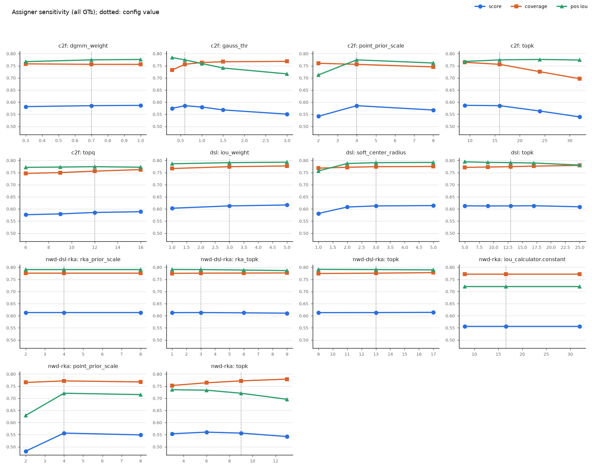
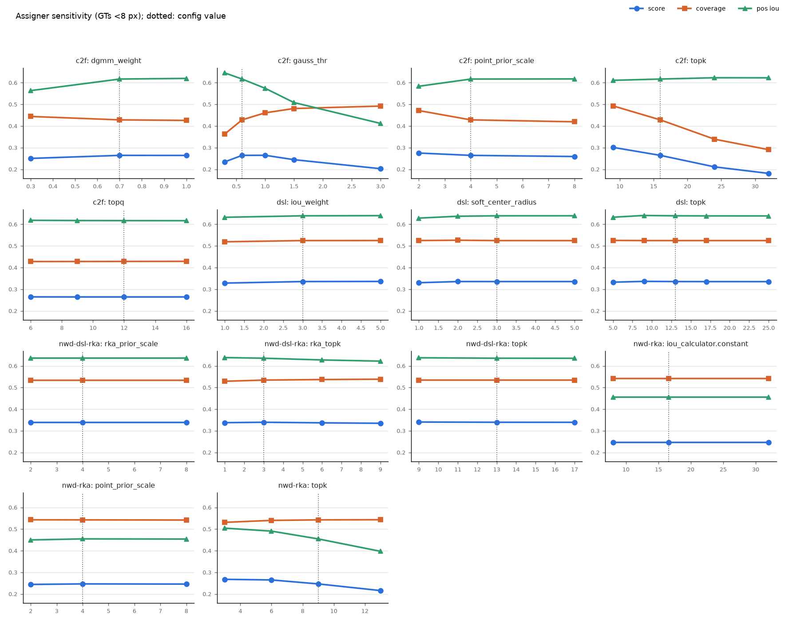

# Label-assigner hyperparameters: guide, probe and search

This covers the label assigners of the RTMDet-P2 detectors (DSL, NWD-RKA, NWD-DSL-RKA and DCFL's C2F), what
each of their hyperparameters does, and two tools that find good values for a config without training a model
for every candidate:

| tool | question it answers | cost |
|---|---|---|
| `assigner_probe.py` | what would each candidate assigner *train on*? | one forward per image, then seconds (GPU) to a minute (CPU) per candidate; about an hour for 42 candidates on 24 CPU cores |
| `assigner_search.py` | which of the probe's best candidates gives the best val mAP? | successive halving over short trainings, about 3 full-run equivalents for 6 candidates |
| `AssignmentLogHook` + `assignment_log_report.py` | is an object the probe finds starved starved once, or for the whole run? | one training run with the hook in the config |

All numbers below are from SODA-A (`configs/soda_dinov3`, 800×800 patches, P2–P5 point priors). The model
comparison is in `configs/soda_dinov3/README.md`.

## Summary

- **Which assigner:** use **NWD-DSL-RKA** (or plain DSL) by default. With CoMer, DSL, NWD-DSL-RKA and DCFL
  finish within 0.3 mAP of each other (38.5 / 38.5 / 38.2), and NWD-RKA is 2 points behind (36.5). The probe
  shows why:
  - NWD-DSL-RKA leaves the fewest objects under 8 px untrained: 1–3%, against 4–7% for DSL and 25–33% for C2F
    in the probes.
  - Logged over whole ConvNeXt-T trainings, C2F leaves 13.1% of the objects under 8 px without a positive in all
    6 epochs, so they are trained only as background. DSL leaves 0.5% (see
    [Starved once or always?](#starved-once-or-always)).
  - Its positives fit as well as DSL's.
  - It is the least sensitive to its hyperparameters.
  - DCFL's +2.1 mAP on ConvNeXt-T most likely comes from its head, not its assigner (see
    [Which framework is better](#which-framework-is-better)).
- **What the hyperparameters actually do on SODA-A:**
  - **DSL and NWD-DSL-RKA are flat.** The probe score moves by less than 0.02 across the whole sweep. The one
    setting that hurts is `soft_center_radius=1`.
  - **C2F is sensitive.** Its coarse `topk` and `gauss_thr` swing the share of untrained objects under 8 px
    between 2% and 53%.
  - **NWD-RKA's `topk` sets a quality/quantity trade-off.** With 9 positives, objects under 8 px get boxes at IoU
    0.39–0.45.
  - **Two knobs do nothing to the positives:**
    - the NWD constant `C` of RKA, because ranking by NWD does not depend on `C`; it only moves the
      negative/ignore split;
    - `rka_prior_scale` of NWD-DSL-RKA.
- **How to tune quickly:**
  1. Fix the test-time caps first.
  2. Probe about 100 training images with one checkpoint.
  3. Run a successive-halving search over the best 4–6 candidates, on slurm.
  4. Confirm the winner with full runs on 2 seeds.

  See [Procedure](#procedure-for-a-new-config-or-dataset).

## What an assigner decides

For every training image, the assigner labels every prior (one per feature-map location per FPN level, about 53k
for an 800×800 patch at P2–P5) as positive for one GT, negative (background) or ignored. The head then learns:

- box regression on the positives;
- a classification target of IoU(prediction, GT) on positives (QFL soft label) and 0 on negatives.

All four assigners answer the same questions:

1. **Candidates:** which priors may represent a GT? This is geometry: inside the box, or the k nearest by a
   distance.
2. **Selection:** how many positives, and which ones? Either a static top-k, or a choice that depends on the
   current predictions (dynamic k, cost).
3. **Conflicts:** who gets a prior that several GTs want?
4. **Negatives and ignores:** what happens to the priors that are not chosen.

Tiny, dense objects make every answer fragile:

- At P2 the priors are 4 px apart. A 3.6 × 13 px vehicle, rotated, may contain no prior centre at all.
- The nearest priors of neighbouring objects overlap.
- A box predicted for a 6 px object has a low IoU even when it is only 1 px off.

So the assigner decides whether such an object is trained at all, and how noisy its targets are. That is where
the "sensitivity" comes from.

### Starved objects: worse than unlabelled, but 0% is not the goal

A GT that gets no positive ("starved") is not just left out. RTMDet trains every prior that is not a positive as
background (score target 0): DSL has no ignore band and C2F ignores 0.4% of the priors. The priors on a starved
object are therefore taught that the object is background, which works directly against recall. Starvation in
the size range you care about should be close to zero.

It is a constraint, not the objective. NWD-RKA starves nothing, yet it is the worst assigner here (36.5 mAP, the
worst AP75 and the most false alarms): to give every GT `topk` positives it takes priors whose predicted boxes do
not fit (pos IoU 0.73 against 0.80 for DSL) and that sit off the object. Those positives teach noisy boxes and
raise scores next to objects. The rule used here is therefore:

1. **Cap starvation** in the focus size bin (`--max-starved '<8:0.02'` in the probe and the search).
2. **Within the cap, maximise the quality of the positives** (probe `score` = coverage × pos IoU, then val mAP).

Two more points:

- **Starved at one checkpoint is not the same as never trained.** The probe sees one set of predictions, and
  prediction-aware assigners change their choice as the model changes. `AssignmentLogHook` measures starvation
  over a whole training run. On SODA-A it makes the difference between the two assigners
  ([Starved once or always?](#starved-once-or-always)):
  - DSL's starved tiny objects change from epoch to epoch. 2.2% are starved in a given epoch, but only 0.5% in
    every epoch.
  - C2F starves mostly the same tiny objects every epoch: 18.5% in a given epoch, 13.1% in all of them.
- **Some starvation cannot be fixed by an assigner.** One prior predicts one box, so two objects whose only
  reachable prior is the same cannot both be trained. Only a finer stride (P1) or a larger input scale fixes
  that. Exact duplicate annotations are the extreme case; the tools merge them.

## The assigners and their hyperparameters

### DSL: `mmdet.DynamicSoftLabelAssigner` (RTMDet default)

- **Candidates:** every prior whose centre lies inside some GT. A GT can also take candidates that lie inside a
  neighbour.
- **Cost per (prior, GT):**
  - a soft classification cost (BCE against the IoU soft label);
  - `iou_weight · −log IoU(pred, GT)`;
  - a centre prior `10^(d/stride − soft_center_radius)`.
- **Dynamic k:** each GT takes `k = ⌊Σ of its top-topk IoUs⌋ ≥ 1` lowest-cost priors. A prior claimed by several
  GTs goes to the cheapest one.

| parameter | default | what it does | SODA-A probe (plain ConvNeXt-T checkpoint) |
|---|---|---|---|
| `topk` | 13 | Number of IoUs summed into the dynamic k, so the upper bound on positives per GT. | 5 → 25 moves positives per GT from 3.2 to 9.7 and pos IoU from 0.796 to 0.770. Starvation does not change. Score is flat (0.622 → 0.605). |
| `soft_center_radius` | 3.0 | Distance (in strides) where the centre cost reaches 1. Small values allow only priors near the centre. | `1.0` is the one harmful setting (pos IoU 0.784 → 0.742, score −0.04). 2–5 are flat. |
| `iou_weight` | 3.0 | How much the predicted box fit matters relative to class score and centre distance. | 1 → 5: score 0.602 → 0.618, small. |
| `iou_calculator` | `RBboxOverlaps2D` | IoU used for the cost and the soft label. Keep the rotated IoU: an NWD soft label lets negative-size boxes through, see the NWD-RKA config. | — |

**Failure mode:** a GT with no candidate (no prior centre inside any GT nearby) has no positive. No DSL
hyperparameter fixes this. 6–7% of the GTs under 8 px are untrained with every DSL setting probed on the plain
ConvNeXt-T checkpoint. Over a whole training run, the starved objects change between epochs: 2.2% per epoch,
0.5% in every epoch.

### NWD-RKA: `RankingAssigner`

- **Candidates and selection:** each GT takes its `topk` priors by NWD between the GT and a
  `point_prior_scale × stride` box around the prior, whatever the predictions. A prior ranked by several GTs goes
  to the highest NWD.
- **Negatives:** priors whose best NWD is below `neg_thr`. Everything else is ignored.

| parameter | config | what it does | SODA-A probe (plain ConvNeXt-T checkpoint) |
|---|---|---|---|
| `topk` | 9 | Positives per GT, the same for a 5 px car and a 60 px ship. | The main knob. 3 → 13: pos IoU 0.710 → 0.631; under 8 px, 2.8 → 9.2 positives at IoU 0.48 → 0.34. Smaller is cleaner. |
| `point_prior_scale` | 4 | Size of the prior box in strides. Sets which FPN level wins a GT. | 2 puts large objects on fine levels (≥32 px score 0.46 → 0.35). The effect of 8 depends on the checkpoint (0.57 here, 0.41 on the DCFL one); the sample has only 152 GTs of 32 px or more. |
| `iou_calculator.constant` (C) | 16.6 | NWD = exp(−W/C). | **No effect on positives:** the ranking is the same for every C. Only the ignored share changes (1% at C = 8, 21% at C = 32), through `neg_thr`. |
| `neg_thr` | 0.3 | Below it a prior is a negative, otherwise ignored. Tune it together with C. | — |
| `quality_calculator` | `RBboxOverlaps2D` | Soft target of the positives: IoU of the prediction. | — |

**Failure mode:** positives are prediction-blind. Every GT gets `topk` positives even when their predictions do
not fit (pos IoU 0.66–0.73, against 0.78–0.80 for DSL), and the extra positives sit off the object (offset 0.39
GT sizes). This shows up as the worst AP75 and false-alarm behaviour of the four.

### NWD-DSL-RKA: `RankingDynamicSoftLabelAssigner`

DSL whose candidate set also contains each GT's `rka_topk` nearest priors by NWD, so a GT smaller than a stride
always has candidates. The cost, dynamic k and soft labels are DSL's.

| parameter | config | what it does | SODA-A probe (plain ConvNeXt-T checkpoint) |
|---|---|---|---|
| `rka_topk` | 3 | Extra candidates per GT. | 1 → 9: under 8 px, starvation 3.0% → 1.9%, but pos IoU 0.613 → 0.602. 3 is the knee. |
| `rka_prior_scale` | 4 | Prior box size for the NWD ranking. | No measurable effect (2, 4 and 8 give the same positives). |
| `rka_calculator.constant` | 16.6 | NWD constant. | No effect: the ranking is invariant to C. |
| `topk`, `soft_center_radius`, `iou_weight` | as DSL | as DSL | as DSL, flat |

### DCFL: `C2FAssigner` with `RotatedRTMDetSepBNDCFLHead`

1. **Coarse:** each GT takes its `topk` priors by GJSD to a `point_prior_scale × stride` box around the
   DCN-shifted prior. A prior claimed by several GTs goes to the last GT.
2. **Fine:** each GT keeps its `topq` candidates by IoU(pred, GT) + class score.
3. **DGMM:** a positive survives only if
   `w·N(p; GT) + (1 − w)·N(p; mean of the GT's positives) ≥ exp(−gauss_thr)`, where `w` is `dgmm_weight`.

| parameter | config | what it does | SODA-A probe (DCFL checkpoint, GTs < 8 px) |
|---|---|---|---|
| `topk` | 16 | Coarse candidates per GT. | **Counter-intuitive and strong.** More candidates means more starvation: 9 / 16 / 24 / 32 starve 14 / 26 / 42 / 50% of the tiny GTs. Larger candidate sets overlap with neighbours, "last GT wins" takes them away, and the mean of the remaining positives drifts off the object, so DGMM rejects them. |
| `gauss_thr` | 0.6 | DGMM threshold, `exp(−0.6)` = 0.55 density. | The main trade-off. 0.3 / 0.6 / 1.0 / 1.5 / 3.0 starve 40 / 26 / 18 / 8 / 3%, while pos IoU drops 0.645 → 0.412. `constraint: none` starves 1.6% at pos IoU 0.35. |
| `dgmm_weight` | 0.7 | Weight of the GT Gaussian against the positives' mean. | 0.3 halves starvation (26 → 13%) at −0.05 pos IoU. |
| `topq` | 12 | Fine positives per GT. | No effect on tiny GTs (they have fewer candidates than `topq`). Overall score is flat. |
| `point_prior_scale` | 4 | Prior box size for GJSD. | 2 hurts large objects (≥32 px score 0.68 → 0.47), and 8 hurts them more (0.27). Keep it near the mean object size: 4 × 4 px = 16 px ≈ C. |
| `neg_thr` | 0.8 | Coarse metric below which a prior is a negative. | Small ignored share (0.4%). |
| head: `dilation_rate`, `prior_offset_scale` | 3, 0.5 | Context of the head; how far DCN offsets move the priors. | Not probed (model, not assigner). C2F starves 33% of the tiny GTs on the plain-head checkpoint (static priors) and 26% on the DCFL one (shifted priors, different predictions too). |

**Failure mode:** objects under about 8 px. DGMM is built for DOTA-sized objects. On SODA-A it removes the
positives of a quarter of the tiny GTs in the probe sample. Logged over a whole ConvNeXt-T training run, it
leaves 18.5% of them starved in a given epoch and 13.1% (about 8,000 objects) without a positive in any of the 6
epochs. Those are trained only as background. The fixes, in order:
- raise `gauss_thr` to 1.0–1.5;
- lower `dgmm_weight` to 0.3;
- lower `topk` to 9;
- or keep the DCFL head and use NWD-DSL-RKA
  (`configs/soda_dinov3/convnext-t-dinov3_rtmdet-p2-dcflhead-nwd-dsl-rka-6e-soda.yaml`).

### Settings outside the assigner that change the result

- **Test-time caps.** `test_cfg.nms_pre` (per level) and `max_per_img` must exceed the number of objects in the
  densest image. On SODA-A, `nms_pre: 2000` cost DCFL 1.2 mAP and made it look like an assigner failure (see
  `configs/soda_dinov3/README.md`). Fix the caps before comparing assigners.
- **Prior geometry.** `point_prior_scale` / `rka_prior_scale` and the NWD constant should match the object
  sizes of the data. `tools/analysis_tools/nwd_constant.py` gives the mean `sqrt(w·h)`.
- **Soft targets.** Keep the rotated IoU as the QFL target (`quality_calculator` / `iou_calculator`) with
  `exp_on_reg: false`; an NWD or GJSD target lets negative-size boxes through.
- **Duplicate annotations.** SODA-A train has 0.29% exact duplicate boxes (1,744 of 608,682 objects), packed
  into dense patches: one 598-GT patch has 68. Only one copy can own a prior, so the other copies are always
  "starved". The probe merges them.

## The tools

### `assigner_probe.py`: what each candidate trains on

```bash
python tools/assigner_tuning/assigner_probe.py CONFIG --checkpoint CKPT \
    --spec tools/assigner_tuning/specs/soda_rtmdet.yaml --no-config-assigner \
    --num-images 120 [--focus-size '<8'] [--max-starved '<8:0.02'] [--device cpu] [--cfg-options ...]
# or sweep the config's own assigner:
python tools/assigner_tuning/assigner_probe.py CONFIG --checkpoint CKPT \
    --sweep topk=5,9,17 --sweep soft_center_radius=2,5 [--mode grid]
```

**How it works:**
1. It samples training images stratified by GT count (dense patches are where assigners differ).
2. It runs the model's loss up to the assigner call, through the real pipeline and head (so DCFL's shifted priors
   are included), and caches the assigner inputs.
3. It runs every candidate on the cache. A spec (`specs/soda_rtmdet.yaml`) names assigner families, each a base
   dict plus a one-at-a-time (`oat`) or `grid` sweep, so different assigners are compared on the same
   predictions.

**Outputs** (in `--out-dir`): `probe.md` (ranking, per-size and per-density tables, FPN level shares),
`probe.json`, and `sensitivity.png`. `--rerank` re-renders an existing `probe.json` with another
`--rank-by` / `--focus-size` / `--max-starved`.

**Starvation caps:** `--max-starved BIN:SHARE` (repeatable; `BIN` is a size bin such as `<8` or `8-12`, or
`all`) ranks every candidate over a cap after all candidates within the caps, whatever its score, and marks it ✗
in `probe.md`.

**Metrics** (per GT; exact duplicate GTs are merged):

| metric | meaning | good |
|---|---|---|
| starved | share of GTs with no positive in this assignment, i.e. trained as background | below a cap in the size bin you care about (`--max-starved`) |
| pos/GT | positives per GT | enough to train (≥2), not so many that they include poor priors |
| pos IoU | mean IoU of the positives' predicted boxes with their GT | high: clean regression and soft-label targets |
| coverage | mean over GTs of the best positive's IoU (0 if starved) | high: the recall the targets allow |
| score | coverage × pos IoU, the default ranking | high |
| offset | prior-to-GT centre distance of the positives, in GT sizes | low: positives off the object learn background |
| ignored | priors neither positive nor negative | low unless intended |

**Limits:**
- The probe sees one set of predictions. Use a checkpoint of the same model: a finished run, or a 1-epoch run of
  the baseline.
- The probe compares assigners, not heads. It cannot see what the DCFL head adds.
- `score` favours fewer, better positives. It is a screen for the search, not an mAP predictor; score
  differences below about 0.01 are ties.

### `assigner_search.py`: successive halving with short trainings

```bash
# any machine where tools/train.py runs:
python tools/assigner_tuning/assigner_search.py CONFIG \
    --probe work_dirs/assigner_probe/NAME/probe.json --top 6 --max-starved '<8:0.02' \
    --budgets 0.125 0.25 0.5 --eta 2 --metric soda/mAP --max-parallel 2
# voltronix cluster: every trial is its own slurm GPU job
# (the driver runs in the dev container with the host's slurm client mounted)
tools/assigner_tuning/search_slurm.sh CONFIG --probe .../probe.json --top 6 \
    --cfg-options train_dataloader.dataset.data_root=... val_dataloader.dataset.data_root=... \
    model.backbone.checkpoint=...
```

**How it works:**
- Every trial trains with the config's full schedule on a fixed random share of the training set
  (`train_dataloader.dataset.indices`, nested across budgets) and validates once at the end.
- The config's own assigner runs in every rung as the reference.
- After each rung, the best `1/eta` of the candidates go on with twice the data.
- All trials share the seed and the subset.
- Finished trials are not re-run, so an interrupted search resumes with the same command.
- `--max-starved` drops the probe candidates over the cap before `--top` is taken.

**Outputs:** `search.md` (one column per budget) and `search.json`.

**Cost:** with 6 candidates plus the reference at 1/8, 1/4 and 1/2 of the data, the search costs
7 × 1/8 + 4 × 1/4 + 3 × 1/2 ≈ 3.4 full-run equivalents. For the ConvNeXt-T SODA-A model that is about 4–5
GPU-hours, against 42 full runs for training the probe candidates outright.

**Caveat:** small-data runs can favour different settings than the full run. Read the last rung as a shortlist,
and confirm the winner at full budget.

### `AssignmentLogHook` and `assignment_log_report.py`: starved once or always?

The hook (`mmrotate/engine/hooks/assignment_log_hook.py`) wraps the head's assigner during training and logs,
for every training object (exact duplicates merged) and every epoch, its number of positives and the best IoU of
their predicted boxes. It writes `<work_dir>/assignment_log.npz` after every epoch. Add it to any config:

```yaml
custom_imports: {imports: [mmrotate.engine.hooks], allow_failed_imports: false}
custom_hooks:
  - {type: EMAHook, ...}          # keep the base config's hooks: the list replaces them
  - {type: AssignmentLogHook}
```

`configs/assigner_tuning/` has the SODA-A ConvNeXt-T DSL and DCFL configs with the hook. Summarise one or more
runs:

```bash
python tools/assigner_tuning/assignment_log_report.py DSL=WORK_DIR_A DCFL=WORK_DIR_B \
    --focus-size '<8' --out work_dirs/assign_log/report.md
```

Per size bin: `starved/epoch` (what a one-checkpoint probe measures), `never` (no positive in any epoch, i.e.
trained only as background), `late never` (none in the second half of training), `always`, positives per visit
and best IoU. A second table follows the focus bin epoch by epoch: the share of objects not matched in any epoch
so far. It falls towards `never` when starvation moves between objects, and stays flat when it hits the same
objects every time.

Objects are identified by image path and annotation order, which the pipeline must keep. Flips and rotations
keep it; a crop that drops boxes does not, and those images are skipped.

## SODA-A results

### Does the probe agree with the trained models?

Each CoMer run was probed with its own checkpoint and its own assigner (92 train patches, 11.2k GTs). The mAP
values use the dense-safe test settings.

| run | score | coverage | starved % | starved % < 8 px | pos IoU | test mAP | AP75 |
|---|---|---|---|---|---|---|---|
| CoMer + NWD-DSL-RKA | **0.637** | 0.798 | 0.2 | 1.1 | 0.799 | **38.5** | 32.9 |
| CoMer (DSL) | 0.635 | 0.793 | 0.8 | 6.0 | **0.800** | **38.5** | **33.3** |
| CoMer + DCFL (C2F) | 0.603 | 0.766 | 3.8 | 25.4 | 0.788 | 38.2 | 31.7 |
| CoMer + NWD-RKA | 0.582 | 0.795 | **0.0** | **0.0** | 0.732 | 36.5 | 29.8 |

The score orders the four runs the same way as mAP. Coverage alone does not: NWD-RKA trains every GT but on
poorly fitting priors. Four runs are a small sample, so treat the probe as a screen and let the search decide.

### Starved once or always?

`AssignmentLogHook` logged every training object (606,938 after merging duplicates) in every epoch of two
ConvNeXt-T runs: DSL and DCFL (configs in `configs/assigner_tuning/`, 53 and 76 minutes on one RTX PRO 6000).

| assigner | size (px) | objects | starved per epoch % | never matched % | starved all of epochs 4–6 % | matched every epoch % | positives per visit | best IoU |
|---|---|---|---|---|---|---|---|---|
| DSL | < 8 | 60,943 | 2.2 | **0.5** | 0.8 | 93.6 | 1.8 | 0.568 |
| DSL | 8–12 | 105,349 | 0.1 | 0.0 | 0.0 | 99.7 | 4.8 | 0.709 |
| DSL | ≥ 12 | 440,646 | 0.0 | 0.0 | 0.0 | ≥ 99.8 | 8.7–9.1 | 0.77–0.80 |
| DCFL | < 8 | 60,943 | 18.5 | **13.1** | 15.3 | 75.5 | 3.1 | 0.567 |
| DCFL | 8–12 | 105,349 | 1.0 | 0.3 | 0.6 | 97.9 | 8.0 | 0.695 |
| DCFL | ≥ 12 | 440,646 | 0.0 | 0.0 | 0.0 | 100.0 | 11.7–11.9 | 0.76–0.80 |

Objects under 8 px that were not matched in any epoch so far (%):

| assigner | epoch 1 | ≤ 2 | ≤ 3 | ≤ 4 | ≤ 5 | ≤ 6 |
|---|---|---|---|---|---|---|
| DSL | 4.1 | 1.2 | 0.8 | 0.6 | 0.6 | 0.5 |
| DCFL | 19.9 | 16.2 | 14.6 | 13.8 | 13.4 | 13.1 |

- **DSL starves tiny objects only now and then.** The share that were never matched falls from 4.1% to 0.5%.
  This disproves the geometric explanation given before the measurement: DSL's candidates and costs depend on
  the predictions, so a given object loses out in some epochs and not in others.
- **C2F starves the same objects every epoch.** The curve flattens at 13%: about 8,000 objects under 8 px are
  trained only as background for the whole run. The share grows with crowding: 11% never matched in patches
  under 50 objects, 16% in patches of 200–500. DCFL gives the objects it does match more positives (3.1 vs 1.8
  per visit) of the same quality.
- **The probe measures this correctly.** Probed with these runs' final checkpoints on its 120 sampled patches, it
  reports exactly what the training log shows for the same patches in epoch 6: DSL 1.6%, DCFL 24.2% of tiny GTs
  starved. Its sample is harder than the whole training set (DCFL: 24.2% against 18.4%) because the stratified
  sampler favours crowded patches. Compare probe numbers with each other, not with whole-set numbers.
- **Test mAP of these repeats** (config test settings, `nms_pre` 2000): DSL 36.6, DCFL 36.9, against 36.1 and
  37.2 for the original runs, so DCFL's lead at these settings shrinks from +1.1 to +0.3. Both repeats moved by
  more than the ±0.1 spread of the two DSL seeds (DSL +0.5, DCFL −0.3), so run-to-run noise is larger than two
  seeds suggested. The dense-safe re-test, where the original runs differ by 2.1, has not been run on the
  repeats.

### Sensitivity

All 42 candidates were probed on the ConvNeXt-T + DCFL checkpoint (DCN-shifted priors). The panels show score,
coverage and pos IoU against each swept value; the dotted line marks the config value.



GTs under 8 px only (1,529 of the 11.2k), where SODA-A and the 0.5–0.7 m production vehicles live:



Range of the probe score over each family's sweep (DCFL checkpoint, all GTs / GTs < 8 px):

| family | score, config value | score range | < 8 px: starved % range | < 8 px: pos IoU range |
|---|---|---|---|---|
| DSL | 0.613 | 0.581–0.616 | 2.5–4.6 | 0.629–0.641 |
| NWD-DSL-RKA | 0.613 | 0.611–0.614 | 2.2–3.6 | 0.622–0.638 |
| C2F | 0.585 | 0.539–0.589 | 1.6–50.2 | 0.346–0.645 |
| NWD-RKA | 0.557 | 0.482–0.560 | 0.0–0.3 | 0.397–0.504 |

On the plain ConvNeXt-T checkpoint (static priors) the picture is the same:
- DSL 0.575–0.622;
- NWD-DSL-RKA 0.612–0.619;
- C2F 0.494–0.568, starving 33% of the tiny GTs at the config values;
- NWD-RKA 0.494–0.531.

The full tables are in the probe outputs (see [Reproduce](#reproduce)).

## Which framework is better?

**For an RTMDet-style head on small, dense objects: NWD-DSL-RKA, then DSL. Not plain NWD-RKA. DCFL only as a
head.**

| | DSL | NWD-DSL-RKA | DCFL (head + C2F) | NWD-RKA |
|---|---|---|---|---|
| CoMer test mAP (dense-safe) | 38.5 | 38.5 | 38.2 | 36.5 |
| ConvNeXt-T test mAP | 36.4 | not run | 38.5 | not run |
| GTs < 8 px starved (probe) | 4–7% | 1–3% | 25–33% | 0% (but pos IoU 0.4–0.5) |
| GTs < 8 px never matched in training (ConvNeXt-T) | 0.5% | not logged | 13.1% | not logged |
| sensitivity to its hyperparameters | low | lowest | high (`topk`, `gauss_thr`) | medium (`topk`) |
| knobs worth tuning | `soft_center_radius` ≥ 2 | `rka_topk` 3–6 | `gauss_thr`, `dgmm_weight`, `topk` | `topk`, `neg_thr` with C |
| extra cost | none | one NWD matrix | DCN head (+compute), GJSD | none |

- **DSL** is the robust default: prediction-aware, few knobs, flat response. Its one gap is GTs with no prior
  centre inside them. Over a training run they change from epoch to epoch, so only 0.5% of the tiny objects
  are never matched.
- **NWD-DSL-RKA** closes that gap: tiny-object starvation drops 6.5% → 2.1% at the same pos IoU and the same
  mAP. It matters most where objects are thinner than the P2 stride. Production vehicles of 9–13 m at 0.5–0.7 m
  GSD are 3.6–5 px wide, which makes this the recommended assigner there.
- **DCFL**, on ConvNeXt-T, is +2.1 mAP, while its C2F assignment leaves 13% of the tiny objects untrained for
  the whole run, against 0.5% for DSL. The gain therefore most likely comes from the head (dilated conv + DCNv2
  context, shifted priors). A repeat run at the config test settings narrowed the lead from +1.1 to +0.3, so
  confirm it on more seeds. On the DCFL
  checkpoint the probe ranks NWD-DSL-RKA well above C2F: score 0.613 vs 0.585, tiny GTs starved 2.7% vs 26%.
  The next run to make is the DCFL head with NWD-DSL-RKA:
  ```bash
  tools/soda_dinov3/run_experiments.sh one configs/soda_dinov3/convnext-t-dinov3_rtmdet-p2-dcflhead-nwd-dsl-rka-6e-soda.yaml
  ```
- **NWD-RKA** was made for anchor heads with few positives (RetinaNet, RPN with top 2–3). With an RTMDet head
  and IoU soft labels, its prediction-blind positives cost 2 mAP and the most false alarms. If you need it, use
  `topk` 3–6.

## Procedure for a new config or dataset

0. **Fix the evaluation.** Set `test_cfg.nms_pre` and `max_per_img` above the densest image's object count. On
   SODA-A that is `nms_pre: 30000`, `max_per_img: 3000`. Otherwise you tune against a cap.
1. **Set the geometry from the data.**
   - Mean `sqrt(w·h)` (`tools/analysis_tools/nwd_constant.py`) → the NWD constant, and the prior scale so that
     `scale × 4 px ≈` the typical object.
   - Your deployment size bins → `--size-edges`. For example, 9–13 m vehicles at 0.5–0.7 m are `sqrt(w·h)` ≈
     7–11 px, so use `--size-edges 8 12 20 32 --focus-size 8-12`.
2. **Get a checkpoint.** Run 1 epoch of the baseline config (or reuse a finished run of the same backbone and
   head).
3. **Probe.**
   - Write a spec (start from `specs/soda_rtmdet.yaml`) and probe 100–120 images. That is minutes on a GPU, or
     about an hour on 24 CPU cores for 42 candidates.
   - Cap starvation in your focus size bin (`--max-starved '<FOCUS>:0.02'`) and rank the rest by score. Be wary
     of a candidate that loses more than ~0.02 pos IoU against the config value.
4. **Search.** Run `assigner_search.py` (or `search_slurm.sh`) on the 4–6 best candidates within the cap
   (`--max-starved` again) with budgets 1/8, 1/4, 1/2. For a prediction-aware assigner whose probe starvation is
   borderline, add `AssignmentLogHook` to the trial config to see whether the starved objects are the same ones
   every epoch.
5. **Confirm.** Run full trainings of the winner and the reference on 2 seeds, tested with the step 0 settings.
   A difference under ±0.3 mAP is a tie; then keep the simpler assigner.

## Reproduce

The SODA-A probes above ran on CPU in the dev container. GPU work goes through slurm (`search_slurm.sh`).

```bash
OPTS="model.backbone.checkpoint=None train_dataloader.dataset.data_root=/mnt/zfs/datasets/eo/soda-a/split_800/"
W=work_dirs/soda_dinov3
# 42 candidates on one checkpoint (repeat with the plain ConvNeXt-T run, convnext-t-dinov3_rtmdet-p2-6e-soda)
python tools/assigner_tuning/assigner_probe.py configs/soda_dinov3/convnext-t-dinov3_rtmdet-p2-dcfl-6e-soda.yaml \
    --checkpoint $W/convnext-t-dinov3_rtmdet-p2-dcfl-6e-soda/epoch_6.pth \
    --spec tools/assigner_tuning/specs/soda_rtmdet.yaml --no-config-assigner \
    --device cpu --out-dir work_dirs/assigner_probe/convnext-dcfl-ckpt --cfg-options $OPTS
# tiny-object view of the same probe
python tools/assigner_tuning/assigner_probe.py configs/soda_dinov3/convnext-t-dinov3_rtmdet-p2-dcfl-6e-soda.yaml \
    --rerank --focus-size '<8' --out-dir work_dirs/assigner_probe/convnext-dcfl-ckpt
# each trained CoMer run with its own assigner (validation table)
for n in vits-dinov3-comer_rtmdet-p2-6e-soda vits-dinov3-comer_rtmdet-p2-nwd-rka-6e-soda \
         vits-dinov3-comer_rtmdet-p2-nwd-dsl-rka-6e-soda vits-dinov3-comer_rtmdet-p2-dcfl-6e-soda; do
  python tools/assigner_tuning/assigner_probe.py configs/soda_dinov3/$n.yaml --checkpoint $W/$n/epoch_6.pth \
      --device cpu --out-dir work_dirs/assigner_probe/own-$n --cfg-options $OPTS
done
```

The probes above sampled 92 patches. That is fewer than the 120 requested, because the dense bucket of the first
version of the sampler was short. The sampler now hands the shortfall to the other buckets.

Tests: `pytest tests/test_tools/test_assigner_tuning.py tests/test_engine/test_hooks/test_assignment_log_hook.py`.
